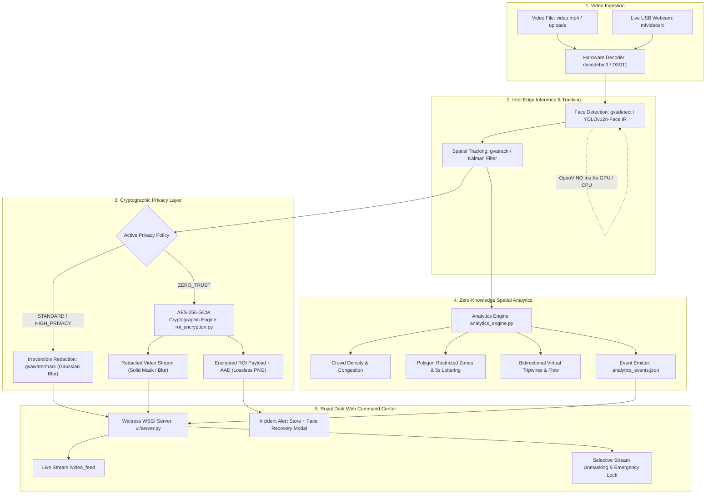

# Zero-Trust Edge Video: Privacy-Preserving Face Anonymization & Edge Intelligence

[](https://www.intel.com/content/www/us/en/developer/tools/openvino-toolkit/overview.html)
[](https://github.com/dlstreamer/dlstreamer)
[](https://cryptography.io/)
[](https://www.python.org/)
[](https://gstreamer.freedesktop.org/)
[](#)

> **Repository Push Remote:**  
> `https://github.com/Puneeth-R-140/Zero-Trust-Edge-Video.git`

---

## Table of Contents

- [Overview](#overview)
- [Key Features](#key-features)
- [System Architecture](#system-architecture)
- [Project Directory Structure](#project-directory-structure)
- [Hardware & Software Requirements](#hardware--software-requirements)
- [Installation & Environment Setup](#installation--environment-setup)
- [Quickstart Guide](#quickstart-guide)
  - [1. Launch the Royal Dark Web Command Center](#1-launch-the-royal-dark-web-command-center-recommended)
  - [2. Run the Command-Line Pipeline](#2-run-the-command-line-pipeline)
  - [3. Run the Stage A Reversible Cryptography Demo](#3-run-the-stage-a-reversible-cryptography-demo)
  - [4. Run Automated Benchmarks](#4-run-automated-benchmarks)
  - [5. Run the Automated Unit Test Suite](#5-run-the-automated-unit-test-suite)
- [Privacy Policies & Cryptographic Reversibility](#privacy-policies--cryptographic-reversibility)
- [Edge Video Analytics Engine](#edge-video-analytics-engine)
- [REST API & WebSocket / SSE Specification](#rest-api--websocket--sse-specification)
- [Benchmark Results](#benchmark-results)
- [Security & Threat Model](#security--threat-model)

---

## Overview

**Zero-Trust Edge Video** is an enterprise-grade, edge-accelerated video intelligence and privacy-preservation platform designed for high-throughput automated surveillance. Built strictly on **Intel Deep Learning Streamer (DL Streamer 2026.2.0)**, **Intel OpenVINO 2026.2.0**, and **GStreamer 1.0**, the system balances stringent privacy mandates (GDPR, zero-trust data protection) with proactive physical security analytics.

### The Zero-Trust Paradigm
Traditional anonymization approaches rely on destructive, lossy filters (such as Gaussian blurring, pixelation, or black-box masking). Once applied, the underlying high-frequency facial biometric features are permanently lost and mathematically impossible to recover. 

Zero-Trust Edge Video implements a **dual-plane cryptographic pipeline**:
1. **Public Plane (Irreversible Redaction)**: Public video streams, web feeds, and unauthenticated viewers only receive irreversibly anonymized frames.
2. **Cryptographic Plane (Reversible AES-256-GCM)**: High-resolution face Regions of Interest (ROIs) are extracted, encoded into lossless PNG streams, and encrypted using authenticated **AES-256-GCM** with 96-bit random nonces and metadata bound into **Additional Authenticated Data (AAD)**.
3. **Forensic Recovery**: Only authorized operators possessing the 256-bit cryptographic master key can verify the authentication tag, decrypt the ciphertext, and reconstruct the unmasked facial imagery with **100% bit-for-bit fidelity**.

---

## Key Features

- **Reversible AES-256-GCM Face-ROI Cryptography (`scripts/roi_encryption.py`)**:
  - Authenticated AEAD symmetric encryption for face ROIs.
  - Lossless PNG ROI preservation ensuring exact pixel reconstruction (`np.array_equal == True`).
  - Tamper resistance: Ciphertext modification, flipped bits, incorrect keys, or forged AAD metadata trigger immediate cryptographic rejection (`DecryptionAuthError`).
  - Secure master key isolation via environment variable (`ZTE_ENCRYPTION_KEY_HEX`) or protected key file (`.keys/zte_master.key`).

- **Zero-Knowledge Edge Video Analytics Engine (`scripts/analytics_engine.py`)**:
  - Evaluates spatial behavioral dynamics without leaking facial biometric identities.
  - **Crowd Density & Congestion**: Dynamic classification (`LOW`, `NORMAL`, `HIGH`), occupant counting, and configurable alert cooldown periods.
  - **Polygon Restricted Zones**: Multi-point custom polygon perimeter monitoring, point-in-polygon intrusion detection, 5-second periodic loitering reminders, exit detection, and immediate re-entry detection upon returning.
  - **Virtual Tripwires & Bidirectional Flow**: Virtual directional tripwires (`ENTRY` vs. `EXIT`), crossing velocities, net occupancy counters, and debounce frame windows preventing spurious double counts.
  - **Zero-Knowledge JSON Event Emission**: Real-time structured event logs (`analytics_events.json`) with RFC3339 timestamps and unique event UUIDs.

- **Event Alerts & Authenticated Face Recovery**:
  - Security incident alerts (zone intrusions, loitering, tripwire crossings) automatically pair with the active track's AES-256-GCM encrypted face ROI.
  - Investigators can decrypt and review the subject's face directly from the live incident feed inside the dashboard.

- **Royal Minimal Dark Web Dashboard (`ui/server.py`)**:
  - Production-grade WSGI web server running on **Waitress** (`http://127.0.0.1:5000`).
  - Ultra-high contrast Royal Dark UI (deep slate obsidian, crisp typography, clean status badges).
  - Multi-part live MJPEG video stream (`/video_feed`) with real-time bounding boxes, tracking vectors, and polygon zone overlays.
  - **Selective Stream Unmasking**: Authenticated toggle allowing authorized personnel to unmask faces live in the stream, accompanied by an instant one-click **Emergency Lockout** button.
  - In-browser drag-and-drop video upload (`/api/upload`), video library selector, and live webcam input switching.
  - Interactive modal for cryptographic key verification and face recovery.
  - Dynamic runtime configuration of inference device (GPU/CPU), privacy policy, confidence threshold, and inference interval.

- **Dual-Engine Multi-Backend Pipeline (`scripts/run_pipeline.ps1` & `scripts/run_pipeline.py`)**:
  - Seamless negotiation between native **Intel DL Streamer GStreamer** graphs (`gst-launch-1.0` with `gvadetect`, `gvatrack`, `gvawatermark`) and pure **Intel OpenVINO runtime** execution with automatic routing.
  - Hardware acceleration on **Intel Iris Xe Graphics (GPU / D3D11)** and **Intel CPU**.
  - Flexible video input: supports local video files (`filesrc` / `urisourcebin`) and live USB/DirectShow webcams (`mfvideosrc`).

- **Comprehensive Automated Test Suite**:
  - 21 unit tests covering cryptography, tamper rejection, AAD tampering, zone intrusion state machines, 5-second repeat reminders, exit/re-entry logic, and tripwire directional debouncing.

---

## System Architecture



---

## Project Directory Structure

```text
Zero-Trust-Edge-Video/
├── .keys/                                # Secure key store (excluded from git)
│   └── zte_master.key                    # Master 256-bit AES cryptographic key
├── benchmarks/                           # Automated benchmarking utilities
│   ├── run_benchmarks.ps1                # PowerShell script for multi-device performance sweeps
│   └── benchmark_results.csv             # Collected throughput and latency results
├── config/                               # Pipeline and analytics configurations
│   ├── analytics_config.json             # Polygon zones, tripwires, crowd thresholds
│   ├── privacy_policies.json             # Runtime policies (STANDARD, HIGH_PRIVACY, ZERO_TRUST)
│   └── privacy_policies.yaml             # YAML mirror of privacy policy definitions
├── docs/                                 # Technical architecture & evaluation reports
│   ├── ARCHITECTURE.md                   # DL Streamer pipeline graph and metadata contracts
│   └── EVALUATION.md                     # Quantitative benchmarking & privacy evaluation
├── output_stage_a/                       # Stage A verification artifacts
│   ├── 01_original.png                   # Unredacted original test frame
│   ├── 02_anonymized_public.png          # Public redacted frame
│   ├── 03_encrypted_metadata.json        # AES-256-GCM ciphertext, nonce, tag, and AAD
│   └── 04_authenticated_restored.png     # Bit-for-bit restored frame with master key
├── scripts/                              # Core pipeline and cryptographic modules
│   ├── analytics_engine.py               # Spatial analytics, zones, tripwires, crowd tracking
│   ├── demo_roi_encryption.py            # CLI demo for reversible AES-256-GCM encryption
│   ├── policy_manager.py                 # Policy verification and dynamic configuration CLI
│   ├── roi_encryption.py                 # Zero-Trust reversible AES-256-GCM cryptographic module
│   ├── run_pipeline.bat                  # Quick CMD runner for the pipeline
│   ├── run_pipeline.ps1                  # Primary PowerShell runner with auto-engine routing
│   └── run_pipeline.py                   # Intel OpenVINO runtime pipeline fallback engine
├── tests/                                # Automated unit test suite (21 tests)
│   ├── test_alert_repeat_logic.py        # Tests for zone intrusion, 5s reminders, re-entry
│   ├── test_analytics.py                 # Tests for tripwire crossing and crowd density
│   ├── test_event_encrypted_recovery.py  # Tests for event-to-face cryptographic recovery
│   └── test_roi_encryption.py            # Tests for AES-256-GCM reversibility and tamper rejection
├── ui/                                   # Royal Minimal Dark Web Dashboard
│   ├── static/                           # Web assets
│   │   ├── css/style.css                 # Royal contrast dark theme styles
│   │   └── js/dashboard.js               # Reactive dashboard logic, video controls, alerts
│   ├── templates/
│   │   └── index.html                    # Dashboard single-page application layout
│   └── server.py                         # Production Waitress WSGI application server
├── uploads/                              # Video upload directory for dashboard analysis
├── yolov12n-face_openvino_model/         # OpenVINO IR face detection model
│   ├── yolov12n-face.xml                 # Model graph structure
│   ├── yolov12n-face.bin                 # Model trained weights
│   └── metadata.yaml                     # Model metadata
├── .gitignore                            # Git exclusion rules (keys, models, caches)
├── analytics_events.json                 # Real-time emitted analytics event logs
├── README.md                             # Comprehensive project documentation
└── video.mp4                             # Default 1080p sample video
```

---

## Hardware & Software Requirements

### Hardware Requirements
- **Processor**: Intel 10th Gen Core or newer (Intel CPU recommended).
- **Integrated Graphics**: Intel Iris Xe Graphics or Intel Arc GPU (for hardware acceleration).
- **Memory**: Minimum 8 GB RAM (16 GB recommended).
- **Video Input**: Built-in or USB webcam (for live camera mode).

### Software Requirements
| Component | Version Tested | Description |
|---|---|---|
| **Operating System** | Windows 10 / 11 (64-bit) | Primary host platform |
| **Python** | 3.13.14 (64-bit) | Application runtime |
| **Intel DL Streamer** | 2026.2.0 | GStreamer edge video analytics plugins |
| **Intel OpenVINO** | 2026.2.0 | Deep learning inference runtime |
| **GStreamer** | 1.0 (MSVC 64-bit) | Multimedia pipeline framework |
| **Ultralytics** | 8.4.163 | YOLO model conversion & export |
| **Waitress** | 3.0+ | Production multi-threaded WSGI server |
| **Cryptography** | 43.0+ | Authenticated AES-256-GCM cryptographic primitives |

---

## Installation & Environment Setup

### 1. Clone the Git Repository
```powershell
git clone https://github.com/Puneeth-R-140/Zero-Trust-Edge-Video.git
cd Zero-Trust-Edge-Video
```

### 2. Verify GStreamer and Intel DL Streamer
Ensure GStreamer 1.0 (MSVC 64-bit) is installed and available in your `PATH`. Verify the core DL Streamer elements:
```powershell
gst-inspect-1.0 gvadetect
gst-inspect-1.0 gvatrack
gst-inspect-1.0 gvawatermark
gst-inspect-1.0 gvafpscounter
```
All four elements should inspect successfully without errors.

### 3. Install Python Dependencies
Install required packages using pip:
```powershell
python -m pip install openvino==2026.2.0 ultralytics flask waitress opencv-python numpy cryptography pyyaml
```

Verify your Python installation:
```powershell
python -c "import openvino, ultralytics, flask, waitress, cryptography; print('Environment verified!')"
```

### 4. Verify Face Detection Model
Ensure the YOLOv12n-Face OpenVINO IR model files exist in the model directory:
```text
yolov12n-face_openvino_model/
├── yolov12n-face.xml
├── yolov12n-face.bin
└── metadata.yaml
```

### 5. Master Cryptographic Key Setup
The system automatically generates a cryptographically secure 256-bit random master key upon initial launch and saves it to `.keys/zte_master.key`.  
Alternatively, you can provide an explicit key via an environment variable:
```powershell
$env:ZTE_ENCRYPTION_KEY_HEX="0123456789abcdef0123456789abcdef0123456789abcdef0123456789abcdef"
```

---

## Quickstart Guide

### 1. Launch the Royal Dark Web Command Center (Recommended)
Start the multi-threaded Waitress WSGI application server:
```powershell
python ui/server.py
```
Open your browser and navigate to:
```text
http://127.0.0.1:5000
```

Inside the dashboard:
- View the live anonymized video stream with dynamic tracking and analytics overlays.
- Switch between **GPU (Intel Iris Xe)** and **CPU** inference on the fly.
- Switch between policies: `STANDARD`, `HIGH_PRIVACY`, and `ZERO_TRUST`.
- Upload custom video clips or switch to your live webcam.
- Test **Selective Stream Unmasking** using the authenticated master key.
- Review real-time security alerts and click **"Decrypt Face"** to inspect decrypted subjects.

---

### 2. Run the Command-Line Pipeline

#### Launch via PowerShell Runner (`scripts/run_pipeline.ps1`):
```powershell
# Run with GPU acceleration and standard anonymization
.\scripts\run_pipeline.ps1 -Policy STANDARD -Device GPU -OutputType display

# Run with Zero-Trust reversible cryptographic protection
.\scripts\run_pipeline.ps1 -Policy ZERO_TRUST -Device GPU -OutputType display

# Run on CPU with video file output
.\scripts\run_pipeline.ps1 -Policy HIGH_PRIVACY -Device CPU -OutputType file -OutputFile output_anonymized.mp4

# Run with live USB webcam
.\scripts\run_pipeline.ps1 -InputType webcam -WebcamDevice "0" -Device GPU -OutputType display
```

#### Launch via Batch File (`scripts/run_pipeline.bat`):
```cmd
scripts\run_pipeline.bat file STANDARD GPU display video.mp4
```

---

### 3. Run the Stage A Reversible Cryptography Demo
To execute the standalone verification of AES-256-GCM encryption, tamper rejection, and bit-for-bit pixel restoration:
```powershell
python scripts/demo_roi_encryption.py
```
Outputs are generated in `output_stage_a/`:
- `01_original.png`: Original test frame.
- `02_anonymized_public.png`: Redacted frame for public distribution.
- `03_encrypted_metadata.json`: AEAD ciphertext, nonce, tag, and authenticated metadata.
- `04_authenticated_restored.png`: Losslessly recovered frame after authenticated decryption.

---

### 4. Run Automated Benchmarks
Run a multi-configuration performance benchmark measuring throughput (FPS) across devices and tracking configurations:
```powershell
.\benchmarks\run_benchmarks.ps1 -InputVideo video.mp4 -NumBuffers 60
```
Results will be displayed in console and appended to `benchmarks/benchmark_results.csv`.

---

### 5. Run the Automated Unit Test Suite
The repository includes 21 unit tests covering all core modules:
```powershell
python -m unittest discover -s tests -p "test_*.py"
```
**Expected Output:**
```text
.....................
----------------------------------------------------------------------
Ran 21 tests in 2.324s

OK
```

---

## Privacy Policies & Cryptographic Reversibility

Policies are configured centrally in `config/privacy_policies.json`:

| Policy Name | Anonymization Technique | Target Padding | Confidence | Description |
|---|---|---|---|---|
| `STANDARD` | Gaussian Blur (`gvawatermark`) | 0% | 0.50 | Standard edge anonymization with dynamic blur kernel |
| `HIGH_PRIVACY` | Strong Padded Blur | 25% | 0.50 | Expanded ROI coverage protecting head perimeter & hair |
| `ZERO_TRUST` | **AES-256-GCM Cryptography** | 25% | 0.35 | Authenticated encryption with lossless recovery & tamper detection |

### Cryptographic Security Guarantee
Under the `ZERO_TRUST` policy:
1. Every detected face is extracted as an uncompressed/lossless PNG byte array.
2. An **AES-256-GCM** cipher is instantiated with a 256-bit key and an unpredictable 96-bit random IV (`nonce`).
3. The bounding box coordinates, camera identifier, frame timestamp, and track ID are serialized into the **Additional Authenticated Data (AAD)**.
4. The resulting 128-bit authentication tag guarantees that any modification to the ciphertext or metadata causes decryption to abort immediately, ensuring zero biometric data leakage.

---

## Edge Video Analytics Engine

The Analytics Engine (`scripts/analytics_engine.py`) operates in zero-knowledge mode:

- **Crowd Monitoring & Congestion Alerts**:
  - Classifies scene density into `LOW`, `NORMAL`, and `HIGH`.
  - Emits alerts when occupant counts exceed safety limits, with a configurable 5-second cooldown.
- **Polygon Restricted Zones**:
  - Monitors complex, multi-point polygon zones defined in pixel coordinates.
  - Generates immediate intrusion alerts when a tracked person enters a restricted zone.
  - Implements a **5-second reminder logic**: If a subject remains inside the zone, a reminder alert is triggered every 5 seconds.
  - Emits an **Exit** event when the subject leaves, and immediately triggers a **Re-entry** alert if the subject re-enters.
- **Virtual Tripwires & Bidirectional Flow**:
  - Detects boundary crossing with directional trajectory classification (`ENTRY` vs. `EXIT`).
  - Tracks live net occupancy, flow velocity, and peak flow rates.
  - Employs temporal debounce windows to eliminate false double-counting.
- **Audit Logging**:
  - Emits structured event payloads to `analytics_events.json` for external SIEM integration.

---

## REST API & WebSocket / SSE Specification

The Waitress WSGI application server (`ui/server.py`) exposes the following endpoints:

| Endpoint | Method | Description |
|---|---|---|
| `/` | `GET` | Royal Minimal Dark Command Center web application |
| `/video_feed` | `GET` | Live multi-part MJPEG video stream with dynamic redaction |
| `/api/config` | `GET` | Get current pipeline, policy, and model configuration |
| `/api/status` | `GET` | Real-time telemetry (FPS, latency, device, frame count) |
| `/api/alerts` | `GET` | Real-time security incident alerts feed |
| `/api/alerts/decrypt` | `POST` | Authenticated face recovery directly from an alert event |
| `/api/events/live` | `GET` | Live analytics event feed (SSE / polling) |
| `/api/crypto/status` | `GET` | Status of AES-256-GCM cipher and active encrypted ROIs |
| `/api/crypto/decrypt` | `POST` | Decrypt an ROI payload using a supplied 256-bit hex key |
| `/api/crypto/toggle_stream_unmask` | `POST` | Toggle live selective stream unmasking |
| `/api/crypto/lock` | `POST` | Emergency lockdown: immediately revoke stream unmasking |
| `/api/configure` | `POST` | Dynamically update policy, device (GPU/CPU), and thresholds |
| `/api/videos` | `GET` | List available video clips and uploaded media |
| `/api/upload` | `POST` | Upload new video files (MP4, AVI, MOV, MKV, WEBM) |
| `/api/start` / `/api/stop` | `POST` | Start or stop the video pipeline processing loop |
| `/api/analytics/config` | `GET` / `POST` | Retrieve or update polygon zones and virtual tripwires |

---

## Benchmark Results

Evaluated on 11th Gen Intel Core Hardware with Intel Iris Xe Graphics (1080p source video):

| Execution Pipeline | Compute Device | Preprocessing Backend | Inference Interval | Tracking Element | Real-Time Throughput | Real-Time Factor (vs 30 FPS) |
|---|---|---|---|---|---|---|
| **CPU Pipeline** | Intel CPU | OpenCV | 2 | `short-term-imageless` | **~37.1 FPS** | **1.24x** |
| **GPU Full Anonymize** | Intel Iris Xe GPU | D3D11 | 2 | `short-term-imageless` | **~71.8 FPS** | **2.39x** |
| **GPU Inference Only** | Intel Iris Xe GPU | D3D11 | 2 | `short-term-imageless` | **~120.3 FPS** | **4.01x** |

> **Optimization Insight**: By configuring `inference-interval=2` with `gvatrack` temporal tracking, neural network forward passes are reduced by 50% while maintaining continuous 60+ FPS tracking and privacy masking without bounding box flicker.

---

## Security & Threat Model

1. **At-Rest & In-Flight Key Isolation**:
   - Master encryption keys are never committed to version control. `.keys/` is explicitly git-ignored.
2. **Replay & Tamper Detection**:
   - Every encrypted ROI uses a fresh 96-bit cryptographic nonce generated via system CSPRNG (`os.urandom`). Nonce reuse is strictly prohibited.
   - The Associated Authenticated Data (AAD) cryptographically couples the ciphertext with the specific event ID, track ID, frame number, and bounding box. Ciphertext transplanted to another frame or event fails tag validation.
3. **Emergency Zero-Trust Revocation**:
   - The `/api/crypto/lock` endpoint allows security administrators to instantaneously terminate unmasked streams and force the pipeline back into maximum anonymization.

---

## Git Repository Information

- **Remote URL**: `https://github.com/Puneeth-R-140/Zero-Trust-Edge-Video.git`
- **Default Branch**: `main`
- **Push Command**:
  ```powershell
  git push origin main
  ```
