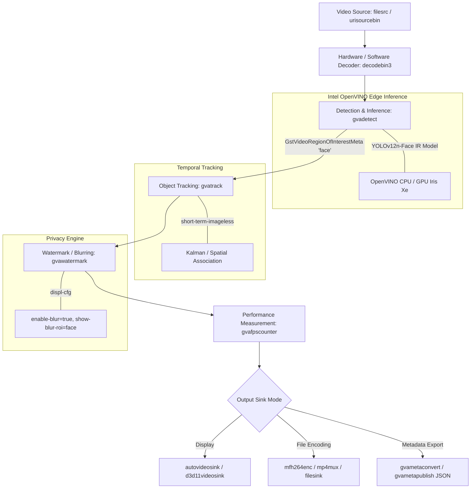

# Face Anonymization Pipeline Architecture

## 1. Overview & Architectural Principles

This project implements an end-to-end privacy-preserving video anonymization system built strictly on **Intel Deep Learning Streamer (DL Streamer 2026.2.0)** and **GStreamer 1.0**.

The system strictly follows the architectural constraint:
- **No standalone custom Python/OpenCV inference loops**: All decoding, OpenVINO neural network inference, ROI metadata propagation, object tracking, blurring, and hardware-accelerated video encoding are managed inside the DL Streamer pipeline graph.
- **ROI Metadata Contract**: Intel DL Streamer uses `GstVideoRegionOfInterestMeta` (and relation metadata) attached to GStreamer buffers as the standard interface between inference (`gvadetect`), tracking (`gvatrack`), metadata formatting (`gvametaconvert`), and anonymization (`gvawatermark`).

---

## 2. Complete Pipeline Graph

---

## 3. Element Configuration & Responsibilities

| Stage | DL Streamer / GStreamer Element | Configuration Parameters | Function |
| :--- | :--- | :--- | :--- |
| **Ingestion** | `filesrc` / `urisourcebin` | `location="video.mp4"` | Ingests video from local file or network streams |
| **Decoding** | `decodebin3` | Auto hardware/software negotiation | Hardware H.264/H.265/AV1 decoding |
| **Edge Inference** | `gvadetect` | `model="yolov12n-face.xml"` `device=CPU/GPU` `inference-interval=2` `threshold=0.5` | Evaluates YOLOv12n-face OpenVINO IR network and attaches ROI labels |
| **Object Tracking** | `gvatrack` | `tracking-type=short-term-imageless` `device=CPU` | Propagates face ROIs across frames, maintaining continuity while reducing inference duty cycle |
| **Anonymization** | `gvawatermark` | `displ-cfg="enable-blur=true,show-blur-roi=face,show-labels=false"` | Applies privacy blurring to detected "face" ROIs |
| **Benchmarking** | `gvafpscounter` | Integrated in pipeline | Real-time and overall FPS and throughput calculation |
| **Encoding / Sink** | `mfh264enc ! h264parse ! mp4mux ! filesink` | Windows Media Foundation H.264 encoder | Outputs compressed anonymized video |

---

## 4. Hardware Acceleration & Benchmarking Analysis

The pipeline supports both **Intel CPU** and **Intel Iris Xe Integrated Graphics (GPU)**.

- **CPU Mode**:
  - `device=CPU pre-process-backend=opencv`
  - Average Processing Throughput: **~37 - 45 FPS**
- **GPU Mode**:
  - `device=GPU pre-process-backend=d3d11`
  - Average Processing Throughput: **~71 - 120 FPS** (depending on encoding sink overhead)
- **Tracking Advantage**:
  - Setting `inference-interval=2` with `gvatrack tracking-type=short-term-imageless` cuts required neural network forward passes by 50% while sustaining full-frame face tracking and blurring.
